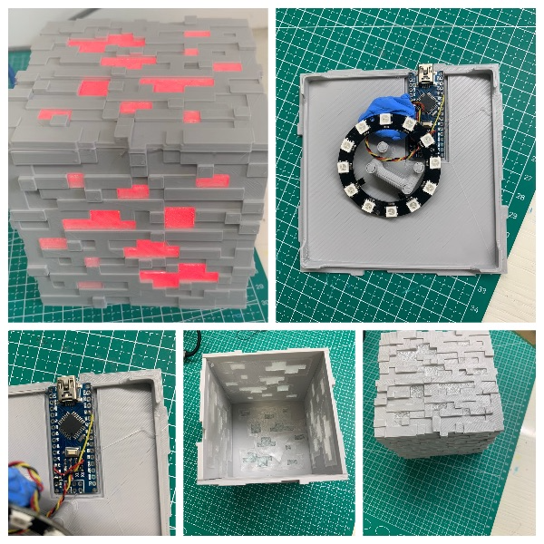
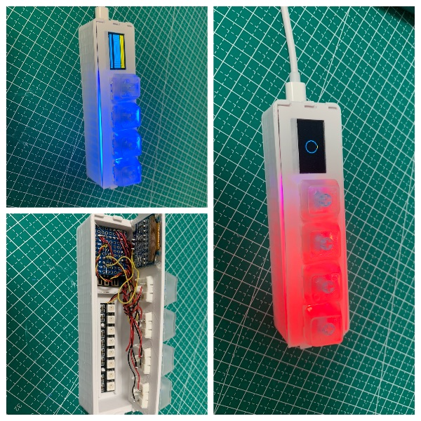
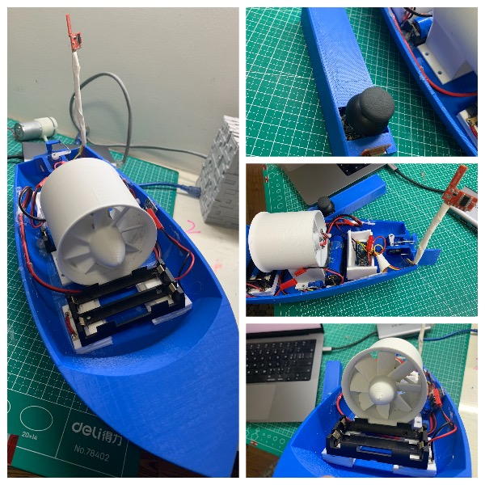

# 3D-Printer-Project

记录使用 3D 打印完成的各类 IoT / 嵌入式项目。

---

## 目录

| 分类 | 项目 |
|------|------|
| 🏠 智能家居 (HomeKit) | [WeMosD1_HomeKit_DHT](#wemosd1_homekit_dht) · [WeMosD1_HomeKit_Occupancy](#wemosd1_homekit_occupancy) |
| ☁️ 阿里云 IoT | [Minecraft_Lamp](#minecraft_lamp) · [WeMosD1_AliyunIoTSDK_Lamp](#wemosd1_aliyuniotsdklamp) · [Tmall-IRRemote](#tmall-irremote) |
| 📷 ESP32 摄像头 | [ESP32_S3_N16R8_CAM_OV3660](#esp32_s3_n16r8_cam_ov3660) · [ESP32_S3_CAM](#esp32_s3_cam) · [ESPCam-BL-AutoLock](#espcam-bl-autolock) |
| 🔭 Raspberry Pi Pico | [Pico_OpenFlexure](#pico_openflexure) · [Pico_SSD1306_IRreceiver](#pico_ssd1306_irreceiver) · [Pico_LCD_st7789](#pico_lcd_st7789) · [Pico_LCD_lvgl](#pico_lcd_lvgl) |
| 📡 红外遥控 | [WeMosS2Mini_IRRemote](#wemoss2mini_irremote) · [Pico_SSD1306_IRreceiver](#pico_ssd1306_irreceiver) |
| ⌨️ 键盘 / 输入 | [QBoard](#qboard) · [KeyBoard_BLE](#keyboard_ble) |
| 🚢 遥控小船 | [QBoat](#qboat) |
| 🔖 NFC | [WeMosD1_PN532_NFC_Reader](#wemosd1_pn532_nfc_reader) |
| 🔒 门禁 / 自动锁 | [AutoLockPC](#autolockpc) · [ESPCam-BL-AutoLock](#espcam-bl-autolock) · [WeMosD1_PC_PowerCtrl](#wemosd1_pc_powerctrl) |
| 💡 灯具 | [Night_Lamp](#night_lamp) · [WeMosD1_Lamp](#wemosd1_lamp) |
| ⚠️ 失败 / 存档 | [HomeKit_ESP01_DHT22_Failed](#homekit_esp01_dht22_failed) · [Pico_lvgl_st7789_failed](#pico_lvgl_st7789_failed) · [ESP32_S3_N16R8_CAM_OV3660_FUSION_TOOL](#esp32_s3_n16r8_cam_ov3660_fusion_tool) |

---

## 智能家居 (HomeKit)

### WeMosD1_HomeKit_DHT

**硬件**：WeMos D1 Mini (ESP8266) + DHT22 温湿度传感器  
**功能**：将温湿度数据接入 Apple HomeKit，可在 iOS「家庭」APP 中实时查看。  
**特性**：
- WiFiManager 一键配网（首次上电生成热点）
- LED 状态指示
- 详细中文安装文档 (`ReadMe.md`)

**接线**：DHT22 数据线 → D2，需 10K 上拉电阻

---

### WeMosD1_HomeKit_Occupancy

**硬件**：WeMos D1 Mini (ESP8266) + 占用/人体传感器  
**功能**：HomeKit 兼容的房间占用检测器，可触发自动化。  
**特性**：
- WiFiManager 配网
- Ticker 定时 LED 闪烁状态提示
- HomeKit 回调处理

---

## 阿里云 IoT

### Minecraft_Lamp

**硬件**：WeMos D1 Mini (ESP8266) + RGB LED  
**外壳**：3D 打印奥德赛魔方灯 · [T站模型](https://www.thingiverse.com/thing:4770169)  
**功能**：通过阿里云生活物联网平台 + 天猫精灵语音控制 RGB 彩灯。



**特性**：
- MQTT 协议连接阿里云
- 手机 APP (云智能) 控制
- 天猫精灵语音控制
- WiFiManager Captive Portal 配网

**参考文档**：[Minecraft_Lamp/README.md](Minecraft_Lamp/README.md)  
**修改版 SDK**：[arduino-aliyun-iot-sdk](https://github.com/xuqi1987/arduino-aliyun-iot-sdk)

---

### WeMosD1_AliyunIoTSDK_Lamp

**硬件**：WeMos D1 Mini (ESP8266) + WS2812B NeoPixel RGB LED  
**功能**：通过阿里云 IoT 平台远程控制 NeoPixel 彩灯，JSON 指令控制颜色。  
**特性**：WiFiManager 配网 · MQTT · NeoPixel 动画

---

### Tmall-IRRemote

**硬件**：WeMos D1 (ESP8266) + IR 发射器  
**功能**：通过阿里云 IoT 平台下发指令，控制 IR 家电（如空调、电视）。  
**特性**：ArduinoJson 解析云端指令 · 电源开关逻辑  
> ⚠️ 注意：代码中不要硬编码 Aliyun 凭据，请使用环境变量或配置文件。

---

## ESP32 摄像头

### ESP32_S3_N16R8_CAM_OV3660

**硬件**：ESP32-S3 (N16R8，8MB PSRAM) + OV3660 摄像头  
**功能**：高性能 RTSP 视频流服务器，支持 MJPEG 和 H.264。  
**特性**：
- RTSP over TCP（兼容 VLC / FFmpeg）
- 37fps @ 640×480
- 多客户端会话管理
- WiFi 自动重连
- H.264 RTP 封装

**文档**：[PROJECT_SUMMARY.md](ESP32_S3_N16R8_CAM_OV3660/PROJECT_SUMMARY.md)

---

### ESP32_S3_CAM

**类型**：3D 设计文件（无固件代码）  
**内容**：ESP32-S3 摄像头模组的 3D 打印外壳（`.stl` / `.3mf`）  
**文件**：机身、面板、底座、支臂、定位销

---

### ESPCam-BL-AutoLock

**硬件**：ESP32 + 摄像头模组  
**功能**：BLE 键盘模拟 + 摄像头 Web 界面，用于 PC 自动锁屏场景。  
**特性**：
- BLE HID 键盘仿真（发送文本、媒体键、组合键）
- 摄像头 Web UI
- 多款 ESP32 摄像头模块引脚配置

---

## Raspberry Pi Pico

### Pico_OpenFlexure

**硬件**：Raspberry Pi Pico (RP2040) + 3 × 28BYJ-48 步进电机  
**功能**：开源显微镜三轴运动控制器（Sangaboard 协议兼容）。  
**特性**：
- X/Y/Z 三轴步进控制
- 串口指令接口（USB）
- 相对/绝对定位
- 速度可调 · 位置记忆/恢复
- Python 测试脚本

**接线**：电机 X → GP2-5 · 电机 Y → GP6-9 · 电机 Z → GP10-13  
**文档**：[Pico_OpenFlexure/README.md](Pico_OpenFlexure/README.md)

---

### Pico_SSD1306_IRreceiver

**硬件**：Raspberry Pi Pico + SSD1306 OLED (128×32, I2C) + IR 接收模块 (GP15)  
**功能**：接收 IR 遥控信号并在 OLED 屏幕上显示 HEX 编码。  
**库**：Adafruit_SSD1306 · Adafruit_GFX · IRremote

---

### Pico_LCD_st7789

**硬件**：Raspberry Pi Pico + ST7789 TFT LCD (SPI)  
**功能**：ST7789 显示驱动 + LVGL GUI 框架移植。  
**文件**：`lv_port_disp.c`（LVGL 显示端口）· `lv_conf.h`（LVGL 配置）

---

### Pico_LCD_lvgl

**硬件**：Raspberry Pi Pico + LCD 显示屏  
**功能**：LVGL 轻量 GUI 库在 RP2040 上的集成示例。  
**状态**：开发中

---

## 红外遥控

### WeMosS2Mini_IRRemote

**硬件**：WeMos S2 Mini (ESP32-S2) + IR 收发模块 + SSD1306 OLED + 按键  
**功能**：万能 IR 遥控接收 & 发射器，支持格力空调协议，OLED 实时显示。  
**特性**：
- IRremoteESP8266 解码接收
- Gree 空调指令发射
- 人体存在感应
- I2C 手动指定 SDA/SCL 引脚

---

## 键盘 / 输入

### QBoard

**硬件**：WeMos D1 Mini (ESP8266) + 4 按键 + 8 像素 WS2812B RGB 灯带 + SSD1306 OLED  
**外壳**：自定义 3D 打印 Mini 键盘外壳  
**功能**：可编程快捷键迷你键盘，带彩灯和信息显示屏。



**特性**：
- 4 个可自定义快捷键（D5-D8）
- RGB 灯带动画
- OLED 状态信息显示
- 按键防抖处理

**代码结构**：
```
src/
  main.cpp          # 主程序 & 显示 Demo
  ButtonDebounce.cpp
  ButtonHandler.cpp
  Light.cpp
include/
  Device.h
  ButtonHandler.h
  Light.h
```

---

### KeyBoard_BLE

**硬件**：ESP32  
**功能**：BLE HID 键盘示例，通过蓝牙发送按键、媒体键和组合键（如 Ctrl+Alt+Del）。  
**用途**：可作为无线快捷键控制器模板。

---

## 遥控小船

### QBoat

**硬件**：Arduino Nano × 2 + 蜂鸟灵系列 T2/R2 2.4GHz 无线模块  
**船体模型**：[Thingiverse #274054](https://www.thingiverse.com/thing:274054)  
**功能**：风力驱动 3D 打印小船 + 自制 3D 打印手柄遥控器。



**特性**：
- 长距离 2.4GHz 无线通信
- 前进 / 停止控制
- 船体和遥控器均为 3D 打印

**代码结构**：
```
BoatControl/   # 小船主控代码
QBoat-Joy/     # 手柄遥控代码
doc/           # 文档
```

---

## NFC

### WeMosD1_PN532_NFC_Reader

**硬件**：WeMos D1 Mini (ESP8266) + PN532 NFC/RFID 模块 (I2C)  
**功能**：NFC 标签读取器，读取 UID 后通过 HTTP POST 上传至服务器。  
**特性**：
- Captive Portal 配网（热点 `NFC_Reader_Config`，密码 `12345678`）
- 支持 MIFARE 1KB 标签
- EEPROM 保存配置
- JSON 数据格式上传

**接线**：PN532 IRQ→D1 · RST→D2 · SDA→D4 · SCL→D5，供电 3.3V  
**文档**：[WeMosD1_PN532_NFC_Reader/README.md](WeMosD1_PN532_NFC_Reader/README.md)

---

## 门禁 / 自动锁

### AutoLockPC

**硬件**：ESP8266/ESP32  
**功能**：自动锁定 PC 的控制器（开发中，主程序待实现）。  
**状态**：骨架项目，`src/main.cpp` 为空

---

### WeMosD1_PC_PowerCtrl

**硬件**：WeMos D1 Mini (ESP8266) + LR7843 光耦隔离 MOS 模块  
**功能**：通过局域网 HTTP 接口远程控制 PC 主机的电源（模拟物理电源键的短按 / 长按）。  
**特性**：
- ESP-IDF v4.4 原生固件（仓库内首个 WeMosD1 ESP-IDF 项目）
- Web 控制页面（手机/电脑浏览器访问）
- RESTful JSON API，便于接入 Home Assistant
- 板载 LED 状态指示（WiFi 未连/已连/动作触发）
- 短按 300ms 开机 / 唤醒，长按 5s 强制断电

**参考文档**：[WeMosD1_PC_PowerCtrl/README.md](WeMosD1_PC_PowerCtrl/README.md)

---

## 灯具

### Night_Lamp

**硬件**：WeMos D1 Mini (ESP8266)  
**功能**：简易夜灯 / 氛围灯控制器。  
**状态**：已实现

---

### WeMosD1_Lamp

**硬件**：WeMos D1 Mini (ESP8266)  
**功能**：基础灯控程序（骨架，待扩展）。  
**状态**：`src/main.cpp` 为空

---

## 失败 / 存档项目

### HomeKit_ESP01_DHT22_Failed

**目标**：在 ESP-01S 上实现 HomeKit 温湿度传感器  
**失败原因**：ESP-01S 仅有 512KB Flash，不足以同时容纳 WiFiManager + HomeKit + DHT 库，且存在 `base64.h` 头文件冲突。  
**解决方案**：改用 WeMos D1 Mini Lite，参见 [WeMosD1_HomeKit_DHT](#wemosd1_homekit_dht)。

---

### Pico_lvgl_st7789_failed

**目标**：在 Pico 上同时运行 ST7789 驱动 + LVGL GUI  
**失败原因**：内存或兼容性问题。  
**替代方案**：参见 [Pico_LCD_st7789](#pico_lcd_st7789)（成功版本）。

---

### ESP32_S3_N16R8_CAM_OV3660_FUSION_TOOL

**内容**：摄像头融合/校准测试工具，当前为 LED Blink 模板阶段。  
**状态**：早期开发

---

## 技术栈总览

| 微控制器 | 项目数 |
|----------|--------|
| ESP8266 (WeMos D1 Mini) | 12 |
| ESP32 / ESP32-S2 / ESP32-S3 | 8 |
| Raspberry Pi Pico (RP2040) | 5 |
| Arduino Nano | 1 |

| 连接方式 | 涉及项目 |
|----------|---------|
| WiFi + MQTT (Aliyun IoT) | Minecraft_Lamp · WeMosD1_AliyunIoTSDK_Lamp · Tmall-IRRemote |
| Apple HomeKit | WeMosD1_HomeKit_DHT · WeMosD1_HomeKit_Occupancy |
| Bluetooth LE (HID 键盘) | ESPCam-BL-AutoLock · KeyBoard_BLE |
| RTSP / H.264 视频流 | ESP32_S3_N16R8_CAM_OV3660 |
| NFC / RFID | WeMosD1_PN532_NFC_Reader |
| IR 红外 | WeMosS2Mini_IRRemote · Tmall-IRRemote · Pico_SSD1306_IRreceiver |
| 2.4GHz 蜂鸟无线 | QBoat |


